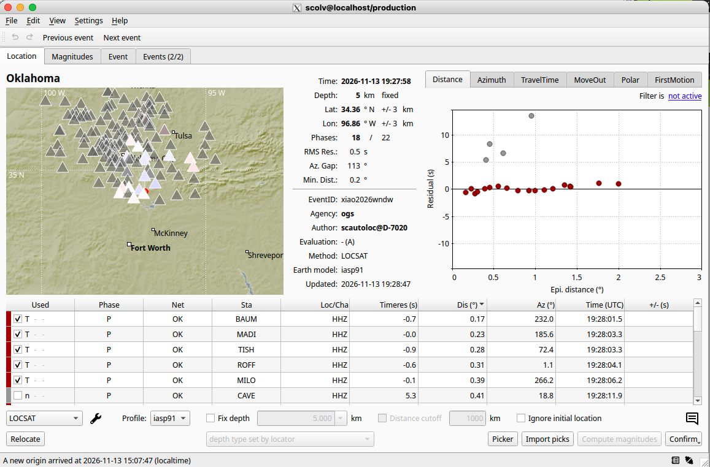
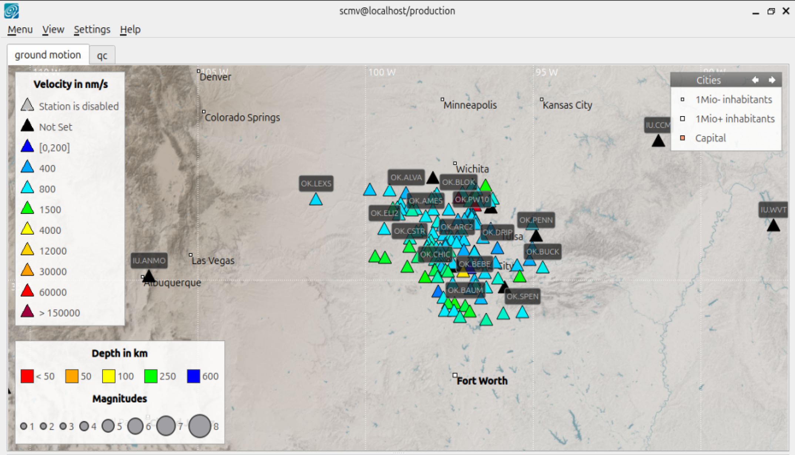
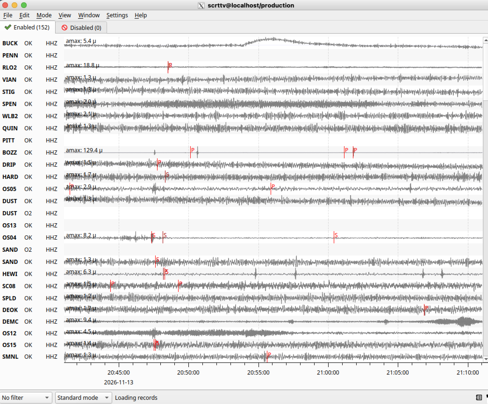
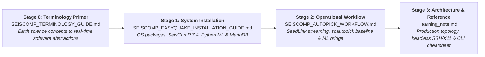

# SeisComP & easyQuake Real-Time Deployment Guides

[ English ](README.md) | [ 简体中文 ](README_zh.md)

> [!IMPORTANT]
> ### 🔗 Upstream Repository
> This repository contains documentation, installation manuals, operational workflows, and presentation materials for integrating **easyQuake** with **SeisComP**.
> 
> For the core source code, native SeisComP wrappers, and official releases, please visit the main upstream repository:  
> **👉 [https://github.com/jakewalter/easyQuake_seiscomp](https://github.com/jakewalter/easyQuake_seiscomp)**

---

## Overview

**`easyQuake_seiscomp` (`sceasyquake`)** bridges modern deep-learning seismic phase pickers (PhaseNet, EQTransformer, GPD via the [SeisBench](https://github.com/seisbench/seisbench) framework) directly into [SeisComP](https://www.seiscomp.de/)'s real-time acquisition and automatic event processing pipeline.

```
┌─────────────────┐       ┌─────────────────┐       ┌─────────────────┐       ┌─────────────────┐
│    SeedLink     │ ────► │   sceasyquake   │ ────► │    scautoloc    │ ────► │  scevent / DB   │
│ Waveform Stream │       │ (PhaseNet / AI) │       │ (Associator)    │       │ (Origins / GUI) │
└─────────────────┘       └─────────────────┘       └─────────────────┘       └─────────────────┘
```

* **Continuous 3-Component Processing**: Evaluates incoming waveforms in sliding buffers (e.g. 60s window every 5s).
* **Simultaneous P & S Wave Picking**: Detects and labels both phase arrivals in real time.
* **Native Message Bus Integration**: Publishes SeisComP data model `Pick` and synthetic `Amplitude` (SNR) objects straight to `scmaster`.
* **Zero Disruption to Duty Seismologists**: Downstream origin declaration (`scautoloc`), magnitude calculation (`scmag`), and graphical review (`scolv`) remain completely native.

---

## Operational Interface Preview

| Origin Locator View (`scolv`) | Real-Time Map View (`scmv`) |
| :---: | :---: |
| <br/>*Duty seismologist review workbench showing waveform alignment and phase picks.* | <br/>*Real-time network map displaying live station ground motion and event origins.* |

| Real-Time Trace View (`scrttv`) |
| :---: |
| <br/>*Continuous multi-channel helicorder stream with real-time automatic detection markers.* |

---

## System Compatibility & Specifications

| Specification | Details |
| :--- | :--- |
| **Target Platform** | **SeisComP 7.4** |
| **Tested Operating System** | **Ubuntu 26.04 LTS** (Resolute Raccoon, x86_64) |
| **Hardware Requirements** | **CPU-only or with GPU** (Both fully supported; multi-core CPU (I tested on 4th i3) is sufficient for 20–50 stations, NVIDIA GPU recommended for 100+ high-frequency channels) |
| **Supported ML Models** | **PhaseNet**, **EQTransformer**, **GPD** (via the [SeisBench](https://github.com/seisbench/seisbench) framework) |
| **Phase Detection** | Continuous 3-component real-time **P and S wave** picking with synthetic SNR amplitudes |
| **Software Stack** | Python 3.10+, PyTorch, ObsPy, SeisBench, MariaDB / MySQL |

---

## Recommended Learning & Deployment Roadmap

Follow these comprehensive guides in sequence depending on your goal:



| Stage | Document | Purpose & Scope | Target Audience |
| :---: | :--- | :--- | :--- |
| **00** | 📖 **[Stage 0: Terminology & Conceptual Primer](SEISCOMP_TERMINOLOGY_GUIDE.md)** | **Foundational Concepts for Earth Scientists**<br/>Bridges undergraduate Earth Science knowledge (P/S waves, seismograms, Richter scale) to real-time software abstractions (miniSEED, StationXML, SeedLink, `scmaster`, bindings, and deep-learning phase pickers). | Undergrads, new researchers, and seismologists new to SeisComP |
| **01** | 🚀 **[Stage 1: System Installation](SEISCOMP_EASYQUAKE_INSTALLATION_GUIDE.md)** | **Day 1: Zero-to-Running Deployment**<br/>Step-by-step instructions for installing SeisComP 7.4 on Ubuntu 26.04 LTS, setting up MariaDB, configuring Python ML environments (PyTorch, SeisBench, ObsPy), and installing `sceasyquake`. | Everyone starting with a fresh Linux machine |
| **02** | ⚙️ **[Stage 2: Real-Time Workflow & Testing](SEISCOMP_AUTOPICK_WORKFLOW.md)** | **Day 2: Operations & Pipeline Validation**<br/>Step-by-step operational guide: streaming public SeedLink stations (Oklahoma network), understanding station bindings, verifying native `scautopick`, and swapping in `sceasyquake` ML. | Operators, researchers, and network analysts |
| **03** | 📚 **[Stage 3: Architecture & Reference Guide](learning_note.md)** | **Ongoing: Advanced Reference & Diagnostics**<br/>Deep dive into production 3-node architecture, duty seismologist `scolv` workflows, headless SSH / X11 tunneling, MariaDB queries, and CLI diagnostic cheatsheets. | System administrators & duty seismologists |
| **Ops** | 🔑 **[Remote Access & SSH Guide](SSH_REMOTE_OPERATIONS_GUIDE.md)** | **Headless Operations & GUI Forwarding**<br/>Generating SSH keys, setting up `~/.ssh/config` aliases, tunneling service ports (SeedLink, MariaDB, Web `scconfig`), running `scolv`/`scmv` over X11 forwarding, and session persistence via `tmux`. | Anyone operating SeisComP on a remote server or VM |
| **Cheatsheet** | 📋 **[Daily CLI Cheat Sheet](SEISCOMP_CLI_CHEAT_SHEET.md)** | **Everyday Command Reference**<br/>Quick copy-paste commands for process restarts, live SeedLink inspection, monitoring PhaseNet picks, MariaDB event queries, database cleanup, and troubleshooting. | Daily operators, analysts, and developers |

---

## Frequently Asked Questions (FAQ)

### How does sceasyquake differ from standard SeisComP scautopick?
Standard `scautopick` uses traditional STA/LTA (short-term average / long-term average) energy threshold triggers on single-component vertical channels. `sceasyquake` applies 3-component deep neural networks (PhaseNet, EQTransformer, GPD) directly to continuous waveform sliding buffers, simultaneously picking both P and S arrivals with significantly higher sensitivity, lower false-positive rates, and synthetic SNR amplitude calculations.

### Does sceasyquake require a dedicated GPU, or can it run CPU-only?
Both CPU-only and GPU configurations are supported. For typical regional monitoring networks (20–50 stations), modern multi-core CPUs easily keep up with real-time inference within the default sliding buffer window (e.g., 60-second window processed every 5 seconds). An NVIDIA GPU (with CUDA drivers) can be enabled optionally for high station density (100+ stations) or low-latency sub-second buffer cycles.

### Which SeisComP version and operating systems are verified?
The deployment guides in this repository are verified on **SeisComP 7.4** running on **Ubuntu 26.04 LTS**. The architecture is also compatible with other Linux distributions and earlier SeisComP releases (e.g., SeisComP 4, 5, and 6).

### How are AI picks associated into earthquake hypocenters and origins?
`sceasyquake` writes native SeisComP `Pick` directly to the `scmaster` messaging bus. Downstream associators—such as `scautoloc` or `scpyocto`—associate these picks into origins completely natively. Downstream modules (`scmag`, `scevent`, MariaDB storage, and `scolv` GUI review) operate with zero modifications to duty seismologist workflows.

### Which deep-learning phase picking models are supported?
`sceasyquake` integrates models supported by the SeisBench framework, primarily:
* **PhaseNet**: High-accuracy, fast 1D convolutional network for P and S arrivals.
* **EQTransformer**: Hierarchical attention-based transformer network for detection and phase picking.
* **GPD** (Generalized Phase Detector): Classic convolutional neural network for P and S detection.

---

## Author & Maintainer

* **Author**: **Hongyu Xiao, Ph.D.**
  * **Role**: Research Scientist / Seismologist & AI Geophysicist, [Oklahoma Geological Survey (OGS)](https://www.ou.edu/ogs), University of Oklahoma
  * **Education**: Ph.D. in Geology & Geophysics, University of Illinois at Urbana-Champaign (UIUC)
  * **Personal Website**: [https://hy-x.github.io](https://hy-x.github.io)
  * **GitHub**: [@Hy-X](https://github.com/Hy-X)

---

## Upstream References & Credits

* **Core Repository**: [jakewalter/easyQuake_seiscomp](https://github.com/jakewalter/easyQuake_seiscomp)
* **easyQuake Framework**: [jakewalter/easyQuake](https://github.com/jakewalter/easyQuake)
* **SeisBench Machine Learning Hub**: [seisbench/seisbench](https://github.com/seisbench/seisbench)
* **SeisComP Official Software**: [seiscomp.de](https://www.seiscomp.de/)

