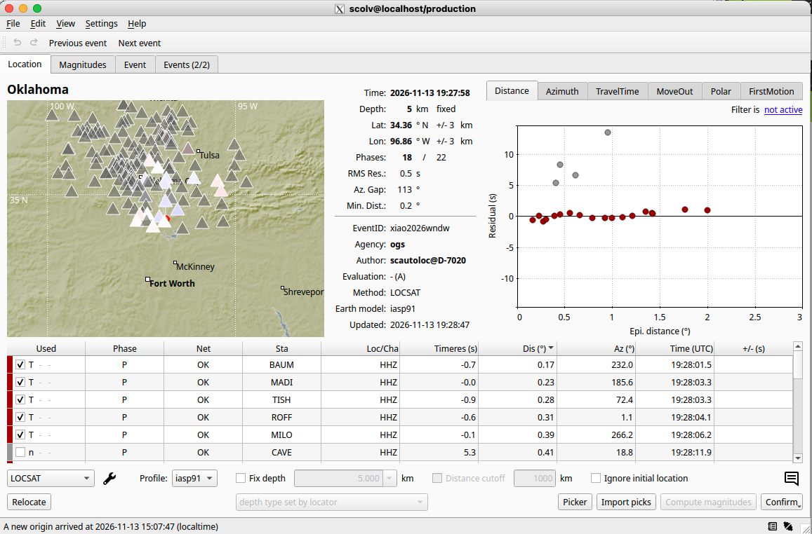
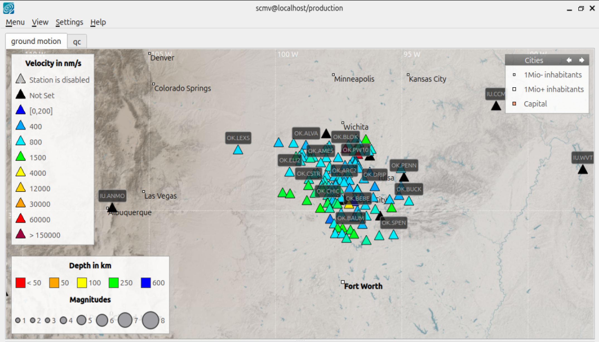
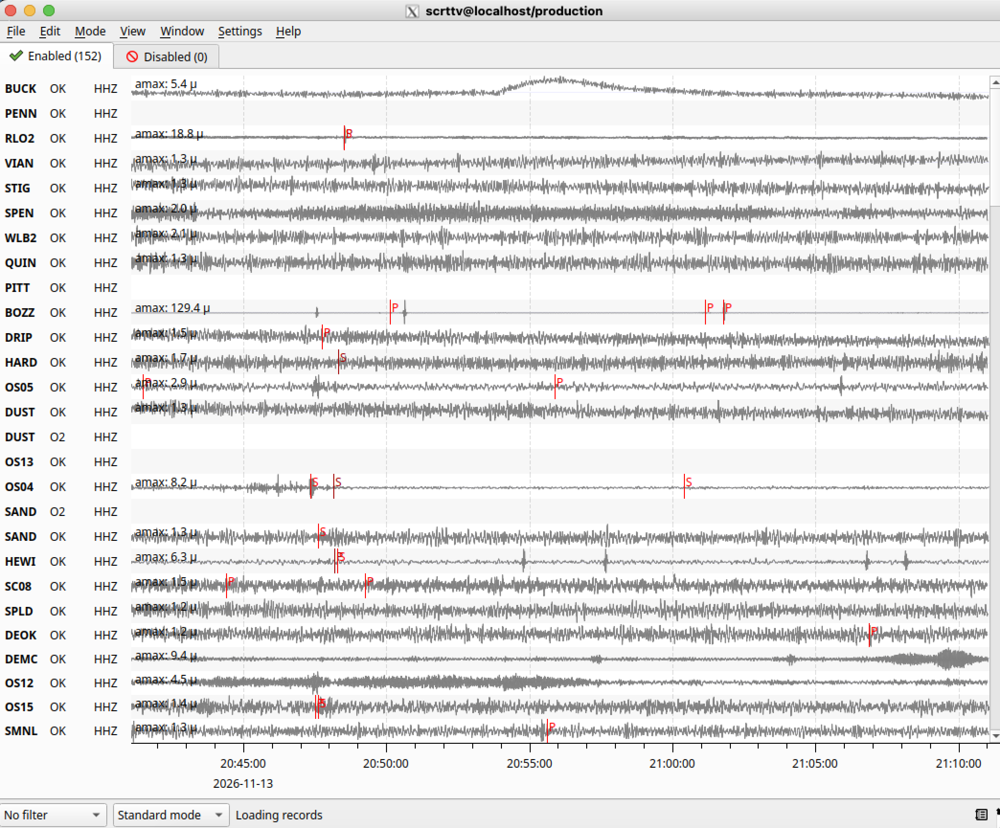
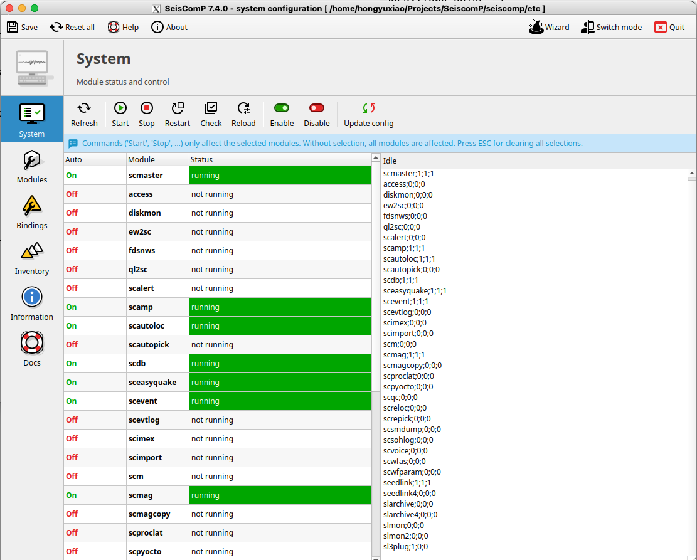
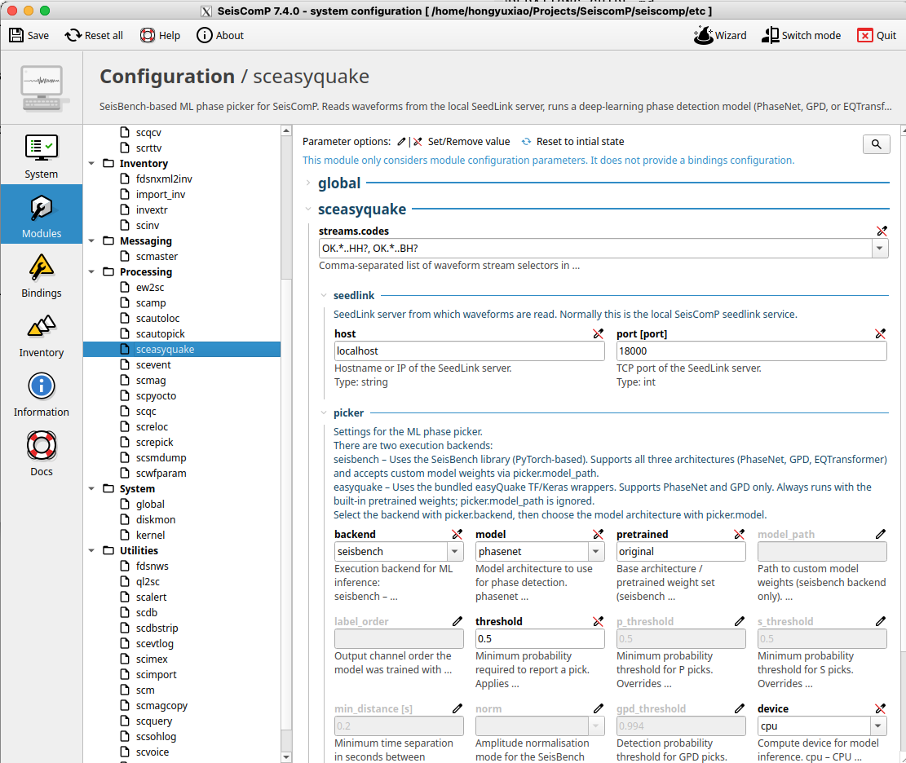
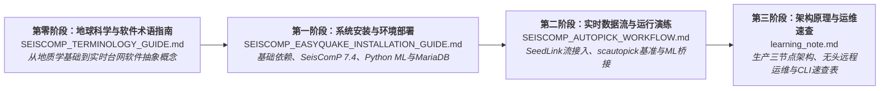

# SeisComP 与 easyQuake 实时系统部署指南

[ English ](README.md) | [ 简体中文 ](README_zh.md)

> [!IMPORTANT]
> ### 🔗 上游代码仓库
> 本仓库包含将 **easyQuake** 深度学习震相拾取系统与 **SeisComP** 地震综合处理平台集成的安装手册、运行架构、运维工作流及演示文档。
> 
> 核心源代码、SeisComP 原生封装脚本及官方发行版本，请访问官方上游仓库：  
> **👉 [https://github.com/jakewalter/easyQuake_seiscomp](https://github.com/jakewalter/easyQuake_seiscomp)**

---

## 项目概述

**`easyQuake_seiscomp` (`sceasyquake`)** 将现代深度学习地震震相自动拾取算法（基于 [SeisBench](https://github.com/seisbench/seisbench) 框架的 PhaseNet、EQTransformer、GPD 等）直接无缝接入 [SeisComP](https://www.seiscomp.de/) 的实时数据流接收与自动化地震事件处理流水线。

```
┌─────────────────┐       ┌─────────────────┐       ┌─────────────────┐       ┌─────────────────┐
│    SeedLink     │ ────► │   sceasyquake   │ ────► │    scautoloc    │ ────► │  scevent / DB   │
│  实时连续波形流  │       │ (PhaseNet / AI) │       │ (震相自动关联器) │       │ (事件目录与GUI)  │
└─────────────────┘       └─────────────────┘       └─────────────────┘       └─────────────────┘
```

* **连续三分量波形处理**：通过滑动时间窗口机制（例如：每隔 5 秒评估一次过去 60 秒的波形缓存）对接收到的实时三分量波形进行连续推理。
* **P波与S波同步高精度拾取**：在流式数据中实时同步检测并标记 P 震相与 S 震相到达时刻。
* **原生消息总线通信**：将标准 SeisComP 数据模型中的 `Pick`（震相时刻）以及合成 `Amplitude`（SNR 信噪比振幅）对象直接发布至 `scmaster` 消息总线。
* **对值班与运维人员工作流零干扰**：下游的初步震源定位声明（`scautoloc` 或 `scpyocto`）、震级测定（`scmag`）以及图形化交互复核（`scolv`）完全保持 SeisComP 原生体验与规范。

---

## 运行界面预览 (GUI Preview)

### 1. 震源定位审定工作台 (`scolv`)
*值班地震专家交互工作台：多台站三分量波形拟合、深度学习 P/S 震相拾取与震源深度复核。*



### 2. 台网实时地图监控 (`scmv`)
*台网全景地图：台站实时地动状态、警报触发与最新地震震中呈现。*



### 3. 实时连续波形监控 (`scrttv`)
*多通道实时滚动记录仪（Helicorder）：展示连续三分量波形与实时自动拾取标记。*



### 4. 系统运行状态与模块监控 (`scconfig`)
*图形化系统管理与服务监控面板：展示核心守护进程运行状态、已启用模块与服务健康度。*



### 5. easyQuake 深度学习模块参数配置 (`scconfig`)
*SeisComP 原生参数配置面板：便捷配置 `sceasyquake` 模型架构（PhaseNet / EQTransformer）、波形数据流代码、设备（CPU/GPU）与推理缓存参数。*



---

## 系统兼容性与技术指标

| 规格维度 | 详细说明 |
| :--- | :--- |
| **目标平台** | **SeisComP 7.4** |
| **测试验证环境** | **Ubuntu 26.04 LTS**（Resolute Raccoon, x86_64） |
| **硬件要求** | **纯 CPU 运行或 GPU 加速均可**（两者均获完整支持；对于 20–50 个常规台站的网络，现代多核 CPU 即可满足实时计算；对于 100+ 高频密集台站，推荐配置 NVIDIA GPU 加速） |
| **支持的 AI 模型** | **PhaseNet**、**EQTransformer**、**GPD**（依托 [SeisBench](https://github.com/seisbench/seisbench) 模型生态） |
| **震相检测能力** | 连续三分量实时 **P 波与 S 波** 同步拾取，并自动生成合成 SNR 振幅对象 |
| **底层技术栈** | Python 3.10+、PyTorch、ObsPy、SeisBench、MariaDB / MySQL |

---

## 推荐学习与部署路线图 (Learning Roadmap)

建议按照以下进阶顺序进行系统阅读与部署实操：



| 阶段 | 文档入口 | 核心定位与内容 | 适用对象 |
| :---: | :--- | :--- | :--- |
| **00** | 📖 **[第零阶段：专业术语与概念基础指南](SEISCOMP_TERMINOLOGY_GUIDE.md)** | **地球科学背景专用桥梁**<br/>将本科地球科学基础概念（断层破裂、P/S波、地震波谱、震级定义）平滑过渡到实时台网软件抽象（miniSEED、StationXML、SeedLink、`scmaster`消息总线、台站绑定及深度学习震相拾取原理）。 | 地学本科生、跨界科研人员及刚接触 SeisComP 的地震学者 |
| **01** | 🚀 **[第一阶段：系统安装与环境部署](SEISCOMP_EASYQUAKE_INSTALLATION_GUIDE.md)** | **Day 1: 从零搭建完整系统**<br/>在 Ubuntu 26.04 LTS 上安装 SeisComP 7.4、配置 MariaDB 数据库、搭建 Python 深度学习虚拟环境（PyTorch、SeisBench、ObsPy）以及安装 `sceasyquake` 模块代码。 | 首次部署系统的技术人员与研究人员 |
| **02** | ⚙️ **[第二阶段：实时数据流与运行演练](SEISCOMP_AUTOPICK_WORKFLOW.md)** | **Day 2: 业务流程与流水线验证**<br/>手把手实操指南：配置公网 SeedLink 实时数据流（俄克拉荷马台网）、掌握台站绑定机制、先验证经典 `scautopick` 基线，再平滑切换为 `sceasyquake` 深度学习拾取器。 | 台网运维人员、算法测试者与地震科研人员 |
| **03** | 📚 **[第三阶段：架构原理与运维速查](learning_note.md)** | **日常维护: 架构参考与诊断工具箱**<br/>深入解析生产级三节点解耦架构、值班地震人员 `scolv` 交互工作流、无头服务器（Headless）SSH/X11 远程显示配置、MariaDB 数据查询及常用 CLI 诊断速查。 | 系统管理员、台网架构师与日常值班分析师 |
| **运维** | 🔑 **[远程运维与 SSH 配置指南](SSH_REMOTE_OPERATIONS_GUIDE.md)** | **无头服务器管理与图形界面转发**<br/>生成 Ed25519 密钥对、免密公钥分发、配置 `~/.ssh/config` 别名、服务端口隧道转发（SeedLink、MariaDB、Web `scconfig`）、通过 X11 Forwarding 运行 `scolv`/`scmv` 图形工具以及使用 `tmux` 维持长时任务。 | 需在远程 Linux 服务器或云虚拟机上操作 SeisComP 的全体用户 |
| **速查** | 📋 **[日常 CLI 运维速查表](SEISCOMP_CLI_CHEAT_SHEET.md)** | **高频命令快速复用手册**<br/>模块启停管理、SeedLink 实时流状态探测、PhaseNet 实时拾取监控、MariaDB 地震事件 SQL 查询、演练数据一键清理及日志排查速查。 | 日常值班台网人员、算法调试者与系统运维人员 |

---

## 常见问题与技术问答 (FAQ)

### sceasyquake 与 SeisComP 原生 scautopick 有何本质区别？
SeisComP 原生自带的 `scautopick` 主要依赖单分量（垂直通道）的经典 STA/LTA（短时平均与长时平均比值）能量触发阈值。`sceasyquake` 则直接利用三分量深度神经网络（PhaseNet、EQTransformer 或 GPD）分析波形的时频特征，在连续滑动窗口中同时高灵敏度地拾取 P 波与 S 波，显著降低由工业干扰、地表噪声引起的假触发率，并自动测算合成信噪比（SNR）振幅。

### sceasyquake 是否必须配备 NVIDIA 独立显卡？纯 CPU 能否满足实时要求？
两者均完全支持。对于常规区域地震台网（20–50 个台站），现代多核 CPU 即可在滑动缓冲区周期内（例如每 5 秒计算一次 60 秒数据）从容完成深度学习模型推理。如果台网规模扩展至上百个高采样率台站，或者需要极低延迟的亚秒级缓冲轮询，可配置带有 CUDA 驱动的 NVIDIA GPU 以实现高并发加速。

### 经过实机测试验证的 SeisComP 版本与操作系统是什么？
本套部署文档已在 **Ubuntu 26.04 LTS** 环境下的 **SeisComP 7.4** 完整测试与稳定验证。其设计遵循标准模块规范，亦兼容其他常见 Linux 发行版及先前的 SeisComP 4、5、6 版本。

### AI 拾取的震相如何关联为地震事件（Origin）？
`sceasyquake` 会生成符合标准 SeisComP 数据模型的 `Pick` 与 `Amplitude` 实例，并通过内部总线广播至 `scmaster`。下游的关联模块（例如官方的 `scautoloc` 或新一代网格搜索关联器 `scpyocto`）可按原生逻辑自动组合拾取结果并求解震源位置。后续的 `scmag`（震级计算）、`scevent`（事件确定）、数据库存储以及 `scolv`（交互审定）均无需修改。

### 系统目前支持哪些深度学习震相拾取算法？
`sceasyquake` 基于 SeisBench 框架提供了多种主流模型的支持，主要包括：
* **PhaseNet**：专为高精度实时 P/S 震相拾取设计的一维 U-Net 卷积神经网络。
* **EQTransformer**：结合层次化注意力机制与 Transformer 架构的地震检测与震相拾取模型。
* **GPD** (Generalized Phase Detector)：经典的深度卷积震相分类与拾取算法。

---

## 作者与维护者信息

* **文档编写与维护者**：**萧鸿宇 博士 (Hongyu Xiao, Ph.D.)**
  * **职务**：研究员 / 地震学家与 AI 地球物理学家，[俄克拉荷马地质调查局 (OGS)](https://www.ou.edu/ogs)，俄克拉荷马大学 (University of Oklahoma)
  * **教育背景**：地质与地球物理学博士，伊利诺伊大学厄巴纳-香槟分校 (UIUC)
  * **个人主页**：[https://hy-x.github.io](https://hy-x.github.io)
  * **GitHub 账号**：[@Hy-X](https://github.com/Hy-X)
  * **研究方向**：机器学习在地震震相拾取与实时监测中的应用、诱发地震学、分布式声波传感 (DAS) 及计算地球物理学。

---

## 上游项目与参考致谢

* **核心封装项目**：[jakewalter/easyQuake_seiscomp](https://github.com/jakewalter/easyQuake_seiscomp)
* **easyQuake 算法框架**：[jakewalter/easyQuake](https://github.com/jakewalter/easyQuake)
* **SeisBench 地球物理机器学习开源库**：[seisbench/seisbench](https://github.com/seisbench/seisbench)
* **SeisComP 官方软件**：[seiscomp.de](https://www.seiscomp.de/)
