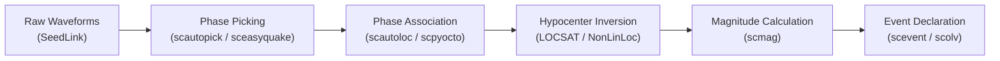

# SeisComP & Real-Time Seismology: Comprehensive Terminology Guide

[ English ](README.md) | [ 简体中文 ](README_zh.md)

This guide bridges the gap between **undergraduate Earth Science concepts** (faults, P/S waves, seismograms, Richter magnitudes) and the **operational software abstractions** used in real-time earthquake monitoring networks (**SeisComP**, **easyQuake**, **SeedLink**, and **MariaDB**).

---

## Table of Contents
1. [From Ground Motion to Digital Streams (Telemetry & Standards)](#1-from-ground-motion-to-digital-streams-telemetry--standards)
2. [The Core Pipeline: Turning Wiggles into Earthquakes](#2-the-core-pipeline-turning-wiggles-into-earthquakes)
3. [Deep Learning vs. Traditional Phase Detection](#3-deep-learning-vs-traditional-phase-detection)
4. [SeisComP System Architecture & Data Model](#4-seiscomp-system-architecture--data-model)
5. [Station Bindings & Configuration Mechanics](#5-station-bindings--configuration-mechanics)
6. [Operator Workflows & Graphical Tools](#6-operator-workflows--graphical-tools)
7. [Quick A–Z Glossary Table](#7-quick-az-glossary-table)

---

## 1. From Ground Motion to Digital Streams (Telemetry & Standards)

In introductory geology, you learn that seismometers record ground motion on paper drum helicorders. In modern digital seismology, mechanical sensors are coupled with high-precision digitizers that stream packets over IP networks.

```
┌─────────────────┐      ┌─────────────────┐      ┌─────────────────┐      ┌─────────────────┐
│ Ground Motion   │ ──►  │ Electromechanical│ ──►  │ 24-bit ADC      │ ──►  │ miniSEED Packets│
│ (Velocity/Accel)│      │ Sensor (e.g. BB)│      │ Digitizer       │      │ (Over SeedLink) │
└─────────────────┘      └─────────────────┘      └─────────────────┘      └─────────────────┘
```

### miniSEED
* **What it is**: The Standard for the Exchange of Earthquake Data (SEED) binary format, stripped down to raw time-series data only.
* **Why it matters**: Each miniSEED record contains 512-byte (or 4096-byte) compressed blocks of raw digital counts, accompanied by precise GPS time headers. It is the universal currency of observational seismology.

### StationXML & Inventory
* **Earth Science Context**: A sensor outputs electrical voltage, which the digitizer converts into arbitrary integer "counts". To convert counts back into actual physical ground velocity ($\text{m/s}$) or acceleration ($\text{m/s}^2$), you need the instrument's **frequency response curve** (poles, zeros, and sensitivity gain).
* **Software Role**: StationXML is an XML standard (FDSN) holding sensor coordinates (latitude, longitude, elevation) and calibration responses. In SeisComP, imported StationXML files form the **Inventory**, without which the system cannot compute physical amplitudes or earthquake magnitudes.

### SEED Channel Naming Convention
You will frequently see stream codes like `OK.ALVA.00.HHZ`. Here is how to decode them:

$$\mathbf{OK} \,.\, \mathbf{ALVA} \,.\, \mathbf{00} \,.\, \mathbf{H} \, \mathbf{H} \, \mathbf{Z}$$

| Code Element | Meaning | Examples |
| :--- | :--- | :--- |
| **Network (`OK`)** | The operating agency or seismic network. | `OK` (Oklahoma Geological Survey), `TX` (TexNet), `IU` (Global Seismograph Network). |
| **Station (`ALVA`)** | The geographic site name (usually 3–5 letters). | `ALVA` (Alva, Oklahoma), `BCOK` (Blaine County). |
| **Location (`00` or `""`)** | Distinguishes multiple sensors at the same site. | `""` (primary sensor), `00` (broadband), `10` (strong motion accelerometer). |
| **Band Code (1st letter: `H`)** | Sample rate & instrument frequency response. | `H` = High Broadband ($\ge 80\text{ to }<250\text{ Hz}$), `B` = Broadband ($10\text{ to }<80\text{ Hz}$), `E` = Extremely Short Period. |
| **Instrument Code (2nd letter: `H`)** | Physical sensor transducer family. | `H` = High Gain Seismometer (weak motion), `N` = Accelerometer (strong motion, near-fault). |
| **Orientation (3rd letter: `Z`)** | Spatial recording axis. | `Z` = Vertical (up/down), `N` = North-South horizontal, `E` = East-West horizontal (or `1`, `2` for orthogonal axes). |

### SeedLink Protocol
* **What it is**: A robust, lightweight TCP protocol designed specifically for real-time seismic data transmission over lossy network links.
* **How it works**: SeedLink runs on port `18000`. Clients can connect, request specific stations and channels (`selectors = HH?`), and receive 512-byte miniSEED packets within 1–3 seconds of ground motion occurring.

### Ringserver
* A high-performance C-based packet ring-buffer developed by EarthScope/IRIS. It holds continuous waveforms in a circular memory buffer and acts as a central distribution hub for incoming and outgoing SeedLink connections.

---

## 2. The Core Pipeline: Turning Wiggles into Earthquakes

Real-time earthquake monitoring is a multi-stage inverse problem:



### 1. Phase Picking (Detection)
* **Concept**: Identifying the exact arrival time ($t_P$ or $t_S$) of seismic body waves on a continuous seismogram.
* **Output**: A **`Pick`** object consisting of:
  * Station & channel (`OK.ALVA..HHZ`)
  * Phase label (`P` or `S`)
  * Arrival timestamp (with millisecond precision)
  * Uncertainty estimate (e.g. $\pm 0.05\text{ s}$)

### 2. Phase Association
* **The Core Problem**: If 20 stations record 40 random P and S picks over a 30-second span, which picks belong to the *same* earthquake, and which picks are noise or from overlapping regional events?
* **Concept**: Phase association is the algorithmic grouping of isolated picks into a coherent spatio-temporal cluster that satisfies theoretical travel times. Modules like **`scautoloc`** or **`scpyocto`** evaluate candidate hypocenters across a spatial grid. Once enough picks fit within allowable residuals (e.g. $\le 1.0\text{ s}$), an **`Origin`** is declared.

### 3. Hypocenter & Origin Inversion
* **Earth Science Terminology**:
  * **Hypocenter**: The 3D physical point of initial fault rupture ($X, Y, Z\text{ depth}$ and Origin Time $T_0$).
  * **Epicenter**: The 2D projection of the hypocenter onto the Earth's surface ($X, Y$).
  * **Origin**: In SeisComP, an `Origin` is a formal mathematical solution representing a specific hypocenter calculation.
* **Travel-Time Residual ($\Delta t$)**:
  $$\text{Residual} = t_{\text{observed}} - t_{\text{calculated}}$$
  Locators iteratively adjust $X, Y, Z, T_0$ to minimize the sum of squared residuals ($\chi^2$).
* **Velocity Models (`iasp91`, `ak135`, regional 1D models)**: Tabulated tables of crustal and mantle P and S wave velocities ($V_P, V_S$) as a function of depth. Locators use these velocity profiles to calculate theoretical travel times.
* **Locators (`LOCSAT` vs `NonLinLoc`)**:
  * **`LOCSAT`**: Standard linearized least-squares matrix inversion. Extremely fast ($<5\text{ ms}$), built into SeisComP, but can get trapped in local minima or push solutions to boundary caps.
  * **`NonLinLoc` (NLL)**: Non-linear probabilistic global grid-search locator developed by Anthony Lomax. Outputs complete 3D spatial probability density functions (scatter clouds) instead of a simple error ellipse.

### 4. Amplitude & Magnitude Estimation
* **`scamp`**: Scans the waveform around the pick window, deconvolves instrument response to recover true ground displacement, and calculates peak amplitudes (e.g. Wood-Anderson equivalent amplitude for $M_L$, or maximum velocity).
* **`scmag`**: Converts measured amplitudes into earthquake magnitudes ($M_L$, $m_b$, $M_w$).
* **Station vs Network Magnitude**: Each individual station calculates a station magnitude ($M_{L,\text{sta}}$). `scmag` trims statistical outliers (median or trimmed mean) to declare the authoritative **Network Magnitude**.

### 5. Event Declaration (`scevent`)
* Multiple origins may be computed for the same earthquake (e.g. a preliminary 4-station origin, followed by an updated 12-station origin, followed by a human-reviewed origin).
* **`scevent`** groups these competing origins together under a single master **`Event`** ID (e.g. `ogs2026abcd`) and designates the most reliable origin as the **Preferred Origin**.

---

## 3. Deep Learning vs. Traditional Phase Detection

### STA/LTA (Traditional Method in `scautopick`)
* **How it works**: Compares the average energy in a **Short-Term Average (STA)** window (e.g. $0.5\text{ s}$, sensitive to transient wave arrivals) against a **Long-Term Average (LTA)** window (e.g. $10\text{ s}$, representing ambient background noise).
  $$\text{Ratio} = \frac{\text{STA}}{\text{LTA}}$$
* **Limitations**:
  * Triggered easily by local cultural noise (traffic, wind, pump jacks, industrial activity).
  * Good at picking sharp, impulsive P-waves; very poor at detecting emergent S-waves embedded within the P-coda.
  * Only uses 1 component (usually vertical `Z`).

### Deep Learning Phase Pickers (`PhaseNet`, `EQTransformer`, `GPD`)
* **How they work**: Neural networks trained on millions of expert-labeled seismograms. They ingest all **three components (Z, N, E)** simultaneously.
* **Key Advantages**:
  * **Simultaneous P and S detection**: Learns the complex elliptical polarization and frequency signatures that differentiate S-waves from P-coda reflections.
  * **High sensitivity at low SNR**: Picks micro-earthquakes buried under background noise that STA/LTA cannot distinguish.
  * **Phase Probability Outputs**: Generates continuous probability distributions $P(t)$ and $S(t) \in [0.0, 1.0]$.
* **Supported Models in `easyQuake`**:
  * **`PhaseNet`**: A 1D convolutional U-Net designed for rapid, high-precision arrival detection.
  * **`EQTransformer`**: Employs self-attention mechanisms (transformers) to detect both the earthquake time window and individual phase arrivals.
  * **`GPD` (Generalized Phase Detector)**: A classic convolutional network for 3-component classification.

### Synthetic SNR Amplitudes in `sceasyquake`
* Downstream associators like `scautoloc` expect an amplitude measurement alongside every pick to filter out false triggers.
* Because raw deep-learning pickers only output time and probability, `sceasyquake` calculates a **synthetic Signal-to-Noise Ratio (SNR) amplitude** directly from the waveform buffer, satisfying SeisComP's data model without needing `scamp` on every pick.

---

## 4. SeisComP System Architecture & Data Model

SeisComP is not a single monolithic program; it is a distributed, decoupled suite of independent C++ and Python daemons communicating over an internal publish-subscribe message bus.

```
┌─────────────────────────────────────────────────────────────────┐
│                     scmaster (Message Broker)                   │
└───────▲───────────────▲─────────────────▲──────────────▲────────┘
        │ PICK          │ LOCATION        │ MAGNITUDE    │ EVENT
┌───────┴───────┐┌──────┴─────────┐┌──────┴───────┐┌─────┴────────┐
│  sceasyquake  ││   scautoloc    ││    scmag     ││   scevent    │
│  (AI Picker)  ││  (Associator)  ││ (Magnitude)  ││ (Organizer)  │
└───────────────┘└────────────────┘└──────────────┘└──────────────┘
```

### `scmaster` (The Central Message Bus)
* The backbone of SeisComP. All modules connect as clients to `scmaster` over TCP (port `18001`).
* Instead of modules talking directly to one another, they publish messages to named **Messaging Groups**:
  * `PICK`: Carried by `scautopick` or `sceasyquake`.
  * `AMPLITUDE`: Carried by `scamp` or `sceasyquake`.
  * `LOCATION`: Carried by `scautoloc` (contains candidate Origins).
  * `MAGNITUDE`: Carried by `scmag`.
  * `EVENT`: Carried by `scevent`.

### `scdb` & Relational Database (MariaDB / MySQL)
* If `scmaster` crashed, in-memory state would be lost. `scdb` subscribes to all messaging groups and persists every object into **MariaDB**.
* **Key Database Tables**:
  * `PublicObject`: Maps universal public identifiers (e.g. `Pick#20261113...`) to internal database object IDs (`_oid`).
  * `Pick`: Arrival times, phase codes, evaluation mode (manual vs. automatic).
  * `Origin`: Hypocenter coordinates, depth, origin time, associator residuals.
  * `Magnitude`: Calculated event magnitudes.
  * `Event`: Public earthquake events and their preferred origin pointers.

### `slarchive` & The SDS Archive
* While `scdb` stores *metadata* (picks, locations, events), it does **not** store continuous waveforms.
* **`slarchive`** subscribes to SeedLink and writes raw continuous miniSEED packets directly to disk organized in the **SeisComP Data Structure (SDS)**:
  ```
  var/lib/archive/YEAR/NET/STA/CHAN.D/NET.STA.LOC.CHAN.D.YEAR.JULIANDAY
  ```
  *Example*: `var/lib/archive/2026/OK/ALVA/HHZ.D/OK.ALVA..HHZ.D.2026.317`

---

## 5. Station Bindings & Configuration Mechanics

SeisComP relies on a hierarchical configuration system to control which modules process which stations.

### Why Are "Bindings" Needed?
An inventory might contain 500 stations across North America. You do not want every module trying to process every station. Bindings explicitly activate a station for specific modules.

### Profiles vs. Per-Station Files
To avoid typing the same settings for 100 stations, SeisComP uses **Profiles**:
1. You define a reusable profile template:
   * *Example*: `etc/key/seedlink/profile_iris` tells SeedLink to fetch data from `rtserve.earthscope.org`.
   * *Example*: `etc/key/global/profile_default` sets `detecStream = "HH,BH"`.
2. You bind stations to those profiles using the SeisComP shell:
   ```bash
   seiscomp shell
   set profile global default OK.*
   set profile seedlink iris OK.*
   ```

### Why `seiscomp update-config` is Mandatory
> [!IMPORTANT]
> SeisComP daemons **never read `etc/key/` text files directly** during real-time operation!  
> Reading hundreds of individual station files dynamically would cause heavy disk I/O bottlenecks.
>
> `seiscomp update-config` acts like a **compiler**: it reads your inventory XMLs, parses your bindings in `etc/key/`, merges them with defaults in `etc/*.cfg`, and compiles consolidated, binary-fast configuration files under **`var/run/`**.

---

## 6. Operator Workflows & Graphical Tools

While the automated pipeline detects earthquakes in seconds, human oversight is critical for network authority and public reporting.

| Application | Full Name | Operational Purpose |
| :--- | :--- | :--- |
| **`scolv`** | Origin Locator View | The primary graphical interactive workbench for **duty seismologists**. Displays arrivals across all stations, allows manual repicking of P and S arrivals, phase pruning, depth locking, locator switching (LOCSAT $\leftrightarrow$ NonLinLoc), and committing authoritative manual solutions. |
| **`scmv`** | Map View | Situational awareness dashboard. Renders a geographical map with live station health, ground motion alarms (color-coded by velocity/acceleration), and newly declared earthquake epicenters. |
| **`scrttv`** | Real-Time Trace View | Digital multi-channel helicorder / oscilloscope. Displays live, streaming waveform traces with pick markers superimposed in real time. |
| **`scconfig`** | Configuration GUI | Graphical utility for managing module configurations, bindings, database settings, and inventory imports. Can run headless over the web via `seiscomp exec scconfig --web 8080`. |

---

## 7. Quick A–Z Glossary Table

| Term | Category | Definition |
| :--- | :--- | :--- |
| **Associator** | Algorithmic Pipeline | Module (`scautoloc`, `scpyocto`) that groups discrete phase picks from multiple stations into a single earthquake origin. |
| **Azimuthal Gap** | Network Geometry | The largest angle (in degrees) between adjacent seismic stations as seen from the earthquake epicenter. A gap $>180^\circ$ significantly degrades horizontal location accuracy. |
| **Bindings** | System Configuration | Station-specific configuration files (`etc/key/`) linking a station to a module profile. |
| **Coda** | Waveform Physics | The trailing, decaying tail of scattered seismic waves following main body and surface wave arrivals. |
| **Deconvolution** | Signal Processing | The mathematical removal of the seismometer's mechanical and electronic response to reveal true physical ground displacement. |
| **Epicenter** | Earth Science | The point on the Earth's surface vertically above the earthquake hypocenter. |
| **FDSN** | International Standard | International Federation of Digital Seismograph Networks; establishes standards like StationXML and FDSN-WS. |
| **Hypocenter** | Earth Science | The 3D subsurface point where fault rupture begins (Latitude, Longitude, Depth, Origin Time). |
| **Inversion** | Mathematics | Solving for unknown source parameters ($X, Y, Z, T_0$) from observed arrival times. |
| **LOCSAT** | Locator Engine | Fast, linearized travel-time inversion algorithm built natively into SeisComP. |
| **miniSEED** | Telemetry Format | Standard compact binary format for recording continuous seismic waveform data. |
| **NonLinLoc (NLL)** | Locator Engine | Non-linear global grid search locator producing full 3D probabilistic hypocenter uncertainty clouds. |
| **Origin** | SeisComP Object | A specific hypocenter solution containing spatial coordinates, depth, time, and associated phase arrivals. |
| **PhaseNet** | Machine Learning | Deep convolutional neural network (1D U-Net) for picking P and S arrivals on 3-component seismograms. |
| **Pick** | SeisComP Object | A discrete seismic phase arrival timestamp on a specific station and channel. |
| **Residual** | Quality Metric | Observed arrival time minus theoretical calculated arrival time ($t_\text{obs} - t_\text{calc}$). Small residuals ($\le 0.5\text{ s}$) indicate a well-constrained origin. |
| **Ringserver** | Network Daemon | Packet ring-buffer server developed by EarthScope/IRIS for streaming miniSEED over SeedLink. |
| **`scmaster`** | Architecture | Central publish-subscribe messaging daemon coordinating all SeisComP modules. |
| **`scolv`** | Graphical Interface | Origin Locator View; the GUI used by duty seismologists to review, repick, and manually commit earthquake origins. |
| **SDS Archive** | Storage Architecture | SeisComP Data Structure; a standardized filesystem hierarchy for day-long continuous waveform miniSEED files. |
| **SeedLink** | Network Protocol | Standard TCP protocol (port 18000) for real-time seismic waveform streaming. |
| **SeisBench** | Machine Learning | Open-source Python benchmark and model repository for machine learning in seismology (PhaseNet, EQTransformer, GPD). |
| **STA/LTA** | Algorithmic Detection | Short-Term Average / Long-Term Average energy ratio trigger algorithm used in classic pickers (`scautopick`). |
| **StationXML** | Metadata Standard | XML standard holding station coordinates, channel configurations, and full instrument response curves. |
